  

  
  
  
  
  
  

---

# 🚀 Awesome AI Model Evaluation

> 🎯 **A comprehensive, SEO-optimized, community-curated list of enterprise SaaS platforms and leading open-source frameworks for LLM evaluation, benchmark harnesses, LLM-as-a-judge scoring, RAG triad assessments, red teaming, and autonomous agent evaluation.**

Whether you are evaluating frontier LLMs, benchmarking RAG pipelines, deploying AI guardrails, or testing multi-step agent trajectories, this repository serves as your definitive guide to AI evaluation infrastructure.

---

## 📑 Table of Contents

- [📊 Sector Overview & Market Dynamics](#-sector-overview--market-dynamics)
- [🏢 SaaS & Hosted Evaluation Platforms](#-saashosted-evaluation-platforms)
- [💻 Top Open-Source Evaluation Projects](#-top-open-source-evaluation-projects)
- [📚 Academic Benchmarks & Evaluation Suites](#-academic-benchmarks--evaluation-suites)
- [💡 Why AI Model Evaluation Matters](#-why-ai-model-evaluation-matters)
- [🤝 How to Contribute](#-how-to-contribute)
- [💖 Support & Sponsorship](#-support--sponsorship)
- [📈 Star History](#-star-history)
- [⚖️ Disclaimer](#-disclaimer)

---

## 📊 Sector Overview & Market Dynamics

The global **AI evaluation, testing, and validation market** is estimated at **$1.3B to $1.6B**, growing at a rapid **CAGR of ~25%–27%** toward an estimated $8B+ by the early 2030s as enterprises move generative AI and autonomous agentic workflows into mission-critical production. 

The sector is currently **moderately fragmented**: specialized startups and open-source ecosystems dominate niche evaluation layers (LLM-as-a-judge, prompt red teaming, hallucination detection, RAG retrieval accuracy, and agent trajectory scoring), while enterprise cloud giants and hyperscalers progressively integrate continuous evaluation and observability into broader LLMOps suites.

---

## 🏢 SaaS & Hosted Evaluation Platforms

The table below lists notable hosted and enterprise-grade AI model evaluation platforms, sorted by **company scale (valuation / revenue)** descending.

| Product | Company Scale (Valuation / Revenue) | Starting Pricing (Paid) | Free Tier Limits / Trial | Core Capabilities & Focus |
| :--- | :--- | :--- | :--- | :--- |
| **[Scale AI](https://scale.com/)** | **$29B valuation** (~$1B–$2B revenue) | **$93,000/yr** (avg contract; custom enterprise quote) | **Trial by request** (Demo & pilot project trial via sales) | Enterprise RLHF human-in-the-loop preference data, red teaming, and frontier model benchmark evaluation against expert graders. |
| **[Snorkel AI](https://snorkel.ai/)** | **$3.5B valuation** (~$375M ARR) | **Custom Enterprise contract** (Annual enterprise pricing) | **60-day evaluation trial** (Complimentary custom LLM eval / pilot PoV via enterprise sales) | Programmatic labeling, programmatic dataset curation, LLM evaluation, and foundation model alignment. |
| **[LangSmith](https://smith.langchain.com/)** | **$1.25B valuation** (LangChain) | **$39/seat/month** (Plus plan) | **Free forever plan**: 1 seat, 5,000 base traces/month, community support, playground access | Native LangChain/LangGraph LLM tracing, unit tests, prompt playground, and multi-turn agent evaluation. |
| **[Braintrust](https://www.braintrust.dev/)** | **~$800M valuation** ($121M raised) | **$249/month** (Pro plan) | **Free forever plan**: Unlimited seats, 1 GB logs/month, 10,000 scores/month, $10 model credits, 14-day retention | Eval-first CI/CD quality gates, AI-assisted Loop Agent for prompt optimization, and automated LLM regression testing. |
| **[Patronus AI](https://www.patronus.ai/)** | **~$440M+ valuation** ($70M raised) | **Usage-based API rates** (Custom enterprise tier available) | **Free developer trial**: $10 in free API credits for automated evaluation & hallucination detection | Automated API evaluation scoring (Lynx model), enterprise hallucination detection, PII leakage, toxicity, and adversarial safety tests. |
| **[Fiddler AI](https://www.fiddler.ai/)** | **~$100M+ raised** (~$9M ARR est.) | **$0.002/trace** (Developer tier pay-as-you-go) | **Free developer plan**: Free tier for small-scale testing of real-time LLM guardrails | Unified AI observability, ML model monitoring, prompt A/B testing, regression testing, and real-time safety guardrails. |
| **[TruEra](https://truera.com/)** | **Acquired by Snowflake** ($43M raised prior) | **Enterprise Snowflake bundle** | **Free trial via Snowflake** (30-day Snowflake trial with $400 credits) | Enterprise AI quality management, test suites, explainability, and observability (incorporated into Snowflake Cortex AI). |
| **[Humanloop](https://humanloop.com/)** | **Acquired by Anthropic** ($8M raised prior) | **Product Sunset** (Team acqui-hired by Anthropic) | **N/A** (Legacy free tier offered 2 seats, 50 eval runs, 10K logs/mo before sunset) | Prompt management, collaborative human feedback, model comparison, and LLM evaluation suites. |

---

## 💻 Top Open-Source Evaluation Projects

Open-source evaluation frameworks provide vendor-neutral, reproducible, and self-hosted model testing. Projects below are sorted by **GitHub Stars_Count** descending.

| Framework | GitHub_Stars | License | Primary Focus & Highlights |
| :--- | :---: | :---: | :--- |
| **[DeepSeek Harness](https://github.com/deepseek-ai/deepseek-harness)** |  | Open-Source | Official modular plugin-based evaluation harness for DeepSeek frontier models. Features live progress UI and standardized reasoning benchmarks. |
| **[FastChat (LMSYS)](https://github.com/lm-sys/FastChat)** |  | Apache-2.0 | Reference platform for LLM evaluation containing **MT-Bench**, Chatbot Arena evaluation pipelines, and LLM-as-a-judge scoring recipes. |
| **[Langfuse](https://github.com/langfuse/langfuse)** |  | MIT | Open-source LLM engineering platform covering tracing, dataset evaluation, LLM-as-a-judge pipelines, and prompt management. Acquired by ClickHouse. |
| **[Promptfoo](https://github.com/promptfoo/promptfoo)** |  | MIT | Lightweight CLI and library for LLM output testing, red teaming, prompt injection defense evaluation, and CI/CD automated quality gates. |
| **[Comet Opik](https://github.com/comet-ml/opik)** |  | Apache-2.0 | Fully open-source end-to-end LLM evaluation and observability platform. Track traces, design custom eval metrics, and evaluate agentic systems. |
| **[OpenAI Evals](https://github.com/openai/evals)** |  | MIT | The standard evaluation framework and benchmark dataset registry created by OpenAI to measure language model capabilities and accuracy. |
| **[DeepEval](https://github.com/confident-ai/deepeval)** |  | Apache-2.0 | "Pytest for LLMs". Ready-to-use metrics: G-Eval, Hallucination, Faithfulness, Context Recall, Bias, and Toxicity with seamless CI/CD integration. |
| **[Ragas](https://github.com/vibrantlabsai/ragas)** |  | Apache-2.0 | The industry standard for evaluating Retrieval-Augmented Generation (RAG) pipelines. Scores faithfulness, answer relevancy, and context precision. |
| **[LM Evaluation Harness](https://github.com/EleutherAI/lm-evaluation-harness)** |  | MIT | Academic benchmark engine powering the Hugging Face Open LLM Leaderboard. Runs 60+ academic evaluations (MMLU, GSM8K, HellaSwag, TruthfulQA). |
| **[Arize Phoenix](https://github.com/Arize-ai/phoenix)** |  | Elastic-2.0 | OpenTelemetry-native AI observability, RAG analysis, LLM benchmark evaluations, and agent execution troubleshooting. |
| **[Cleanlab](https://github.com/cleanlab/cleanlab)** |  | AGPL-3.0 | Standard framework for data-centric AI and automated evaluation dataset curation, catching label errors and hallucinated training examples. |
| **[OpenCompass](https://github.com/open-compass/opencompass)** |  | Apache-2.0 | One-stop evaluation platform for LLMs and large multi-modal models with 100+ benchmark datasets and distributed evaluation pipelines. |
| **[SWE-bench](https://github.com/swe-bench/SWE-bench)** |  | MIT | Benchmark testing LLMs on real-world software engineering GitHub issues. The primary benchmark for evaluating AI coding agents. |
| **[OpenAI Simple Evals](https://github.com/openai/simple-evals)** |  | MIT | Fast, lightweight benchmark evaluation suite from OpenAI for testing models on MMLU, MATH, GPQA, HumanEval, and MGSM. |
| **[TruLens](https://github.com/truera/trulens)** |  | Apache-2.0 | Evaluation and tracking for LLM experiments and RAG pipelines. Evaluates the RAG Triad, agent trajectory adherence, and tool selection. |
| **[Inspect AI](https://github.com/UKGovernmentBEIS/inspect_ai)** |  | MIT | LLM evaluation framework developed by the UK AI Safety Institute for systematic safety, cybersecurity, and reasoning evaluations. |
| **[HELM (Stanford CRFM)](https://github.com/stanford-crfm/helm)** |  | Apache-2.0 | Holistic Evaluation of Language Models from Stanford. Evaluates accuracy, robustness, fairness, bias, toxicity, and efficiency across 30+ scenarios. |
| **[BIG-bench](https://github.com/google/BIG-bench)** |  | Apache-2.0 | Collaborative benchmark with 200+ distinct evaluation tasks testing reasoning, mathematics, logic, and obscure multilingual capabilities. |
| **[AlpacaEval](https://github.com/tatsu-lab/alpaca_eval)** |  | Apache-2.0 | Fast, cost-effective automated evaluator for instruction-following language models, calibrated against human preference rankings. |
| **[AgentCompass](https://github.com/open-compass/AgentCompass)** |  | Apache-2.0 | Unified evaluation infrastructure for multi-step agents. Integrates 30+ benchmarks across tool calling, trajectory recording, and failure modes. |

---

## 📚 Academic Benchmarks & Evaluation Suites

- 🔬 **[MMLU & MMLU-Pro](https://github.com/TIGER-AI-Lab/MMLU-Pro)** — Massive Multitask Language Understanding across STEM, humanities, and social sciences.
- 📐 **[GSM8K](https://github.com/openai/grade-school-math)** — Grade school math benchmark assessing multi-step mathematical reasoning.
- 💻 **[HumanEval](https://github.com/openai/human-eval)** — Python programming problems testing code generation and algorithmic synthesis.
- 🧪 **[GPQA](https://github.com/idavidrein/gpqa)** — Google-proof graduate-level biology, physics, and chemistry question answering.
- 🌐 **[GAIA](https://huggingface.co/datasets/gaia-benchmark/GAIA)** — General AI Assistants benchmark measuring complex multimodal and multi-tool agent workflows.
- 🛡️ **[TruthfulQA](https://github.com/sylphdotai/TruthfulQA)** — Benchmark testing how often models mimic human falsehoods and false conspiracies.

---

## 💡 Why AI Model Evaluation Matters

1. ⚡ **Prevent Quality Regressions:** Quantify model performance across prompt versions, foundation model updates, and temperature tweaks before shipping to production.
2. 🔍 **Diagnose RAG Failures:** Disentangle retrieval failures (poor context recall) from generative hallucinations (poor answer faithfulness).
3. ⚖️ **Automate with LLM Judges:** Scale quality scoring with validated LLM-as-a-judge prompts that correlate strongly with human ground truth.
4. 🤖 **Track Agentic Trajectories:** Evaluate whether multi-step autonomous agents select appropriate tools, follow plans, and recover gracefully from errors.

---

## 🤝 How to Contribute

We welcome additions, corrections, and new benchmark tools! 🌟

1. 🍴 **Fork the repository**
2. 🌿 **Create a new branch** (`git checkout -b feature/add-new-eval-tool`)
3. 📝 **Add your entry** in alphabetical or star-ranked order with accurate descriptions and pricing/Stars_Badges
4. 🚀 **Submit a Pull Request** with a brief summary of the project

---

## 💖 Support & Sponsorship

If you find this repository valuable for your AI engineering workflows, research, or LLMOps architecture, please consider supporting the project:

- ⭐ **Star this repository** to help others discover it
- 🍴 **Fork and share** with fellow ML and AI practitioners
- ☕ **Support the maintainer**: Buy a coffee or become a sponsor on the [GitHub Sponsors Dashboard](https://github.com/sponsors/ishandutta2007)

Thank you for helping keep AI model evaluation transparent, rigorous, and open! 💙

---

## 📈 Star History

---

## ⚖️ Disclaimer

- This is a community-curated list and does not constitute an endorsement of any commercial platform or framework.
- Numbers and benchmark scores across different harnesses or hardware configurations are not directly comparable without standardized environments.
- Always review repository licenses before embedding tools into commercial production pipelines.
